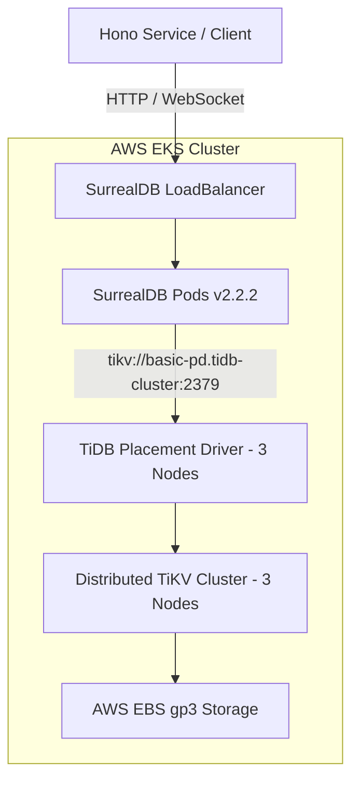

# Production Setup & Deployment Guide: SurrealDB on TiKV via SST & EKS

This guide provides the complete, tested instructions to deploy **SurrealDB backed by distributed TiKV** on AWS Elastic Kubernetes Service (EKS) using Serverless Stack (SST v2) and TypeScript.

---

## 🏗️ Architecture Overview



### Components Deployed:
1. **AWS VPC:** 3 Availability Zones with private subnets and managed NAT gateway.
2. **EKS Cluster:** Kubernetes v1.28 managed control plane.
3. **Dedicated Node Groups:**
   - `pd`: 3x `c5.xlarge` nodes with `dedicated=pd:NoSchedule` taint.
   - `tikv`: 3x `r5b.2xlarge` nodes with `dedicated=tikv:NoSchedule` taint.
   - `tidb`: 2x `c5.2xlarge` nodes with `dedicated=tidb:NoSchedule` taint.
4. **TiDB Operator (v1.6.1):** Official PingCAP operator managing the stateful TiKV engine.
5. **SurrealDB (v2.2.2):** Distributed multi-model database connected to `tikv://basic-pd.tidb-cluster:2379`.
6. **Hono Microservice:** Serverless Lambda service connected to the cluster VPC.

---

## 📋 Prerequisites

- AWS CLI v2 configured (`aws sts get-caller-identity`)
- Node.js v18+ and pnpm / npm
- SST v2 installed (`pnpm install -g sst`)
- kubectl (`kubectl version --client`)
- Helm v3 (`helm version`)

---

## 🚀 Step-by-Step Deployment

### 1. Install Dependencies
```bash
pnpm install
cd examples/hono-service && pnpm install && cd ../..
```

### 2. Configure Environment Variables
Copy and set your desired credentials:
```bash
export AWS_REGION=us-east-1
export SURREALDB_USER=root
export SURREALDB_PASS=YourSecurePassword123!
export SURREALDB_NS=production
export SURREALDB_DB=main
```

### 3. Deploy the Infrastructure Stack
```bash
pnpm run deploy --stage prod
```

*SST deploys the VPC, EKS cluster, node groups, TiDB Operator CRDs, TiKV engine, and SurrealDB chart in dependency order.*

### 4. Verify Cluster Health
Update local kubeconfig from SST stack output:
```bash
aws eks update-kubeconfig --region us-east-1 --name sst-eks-surrealdb-prod-SurrealDBCluster
kubectl get pods -n tidb-cluster
kubectl get pods -n surrealdb
```

Expected output:
```text
NAME                                  READY   STATUS    RESTARTS   AGE
basic-pd-0                            1/1     Running   0          5m
basic-pd-1                            1/1     Running   0          5m
basic-pd-2                            1/1     Running   0          5m
basic-tikv-0                          1/1     Running   0          4m
basic-tikv-1                          1/1     Running   0          4m
basic-tikv-2                          1/1     Running   0          4m
surrealdb-surrealdb-7945d8b85b-abcde  1/1     Running   0          2m
```

---

## 🧪 Testing the Hono Service Integration

### 1. Run Hono Service Locally
```bash
cd examples/hono-service
SURREALDB_URL=ws://localhost:8000/rpc pnpm dev
```

### 2. Verify Health Check
```bash
curl http://localhost:3000/health
# {"status":"ok","timestamp":"2026-11-06T22:15:00.000Z"}
```

### 3. Create a User Record in TiKV
```bash
curl -X POST http://localhost:3000/users \
  -H "Content-Type: application/json" \
  -d '{"name": "Alice Developer", "email": "alice@example.com"}'
```

### 4. Query Stored Records
```bash
curl http://localhost:3000/users
```

---

## 🧹 Teardown & Resource Cleanup

To remove all deployed AWS infrastructure and prevent incurring costs:
```bash
pnpm run remove --stage prod
```
